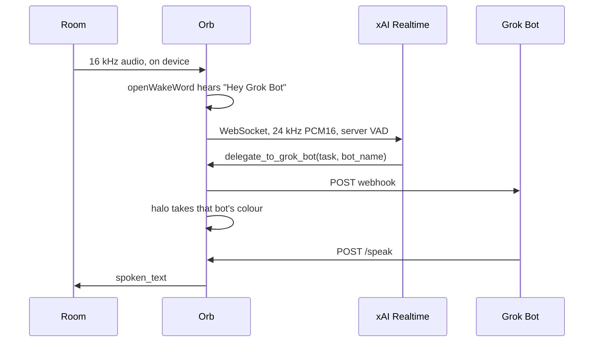

<h1 align="center">Hey Grok Bot Orb</h1>
<p align="center"><strong>A hands-free voice orb for your Grok Bots.</strong></p>

Build a countertop assistant that listens for a wake word locally, talks with you using xAI Realtime, and sends tasks to your Grok Bots. When a bot finishes, the orb speaks its reply and its LED halo shows which bot is working.

Try the callback server on a Linux laptop with Rust 1.91 or later, without a microphone or Pi:

```bash
cargo run --locked -- --dry-run
```

Then visit `http://localhost:8765/health`. For a simulated task and full setup, see [Try it on a laptop](#try-it-on-a-laptop) and [Pi setup](#pi-setup).

**Preview:** The Rust daemon has passed automated protocol and recorded-audio tests. The Pi microphone, speaker and LED ring still need physical validation. See [porting and verification notes](PORTING.md).

**Device preview pending:** An on-device photograph or demo will go here when available.

The enclosure follows a concept render by [@Texas_Twins_Dad](https://x.com/Texas_Twins_Dad); the hands-free request came from [@martin_casado](https://x.com/martin_casado). This is an unofficial community project. Grok, xAI, and Grok Bot are trademarks of their owners.

## How a turn works



1. **Offline wake word (openWakeWord ONNX models in Rust).** The microphone fills a 16 kHz ring buffer. `hey_grok_bot.onnx` scores each 80 ms frame on the device. Until the score crosses the threshold, no audio leaves the orb. If that file is not present, the daemon loads the pretrained `hey_jarvis` model so the rest of the stack can be brought up the same day. Say “Hey Jarvis” in that case.
2. **Sub-400 ms conversational voice (`xAI Realtime API`).** A wake opens `wss://api.x.ai/v1/realtime?model=grok-voice-latest` with `server_vad`, little-endian mono PCM16 at 24 kHz, and `reasoning.effort` set to `none`. The pre-roll in the ring is sent as soon as the socket is up, so the start of the sentence is not clipped. The sub-400 ms figure is the model’s turn latency once that socket is open. If the ALSA device is running at 16 kHz or 48 kHz, the daemon resamples in both directions.
3. **Real agent action (`Grok Bot Webhook Routine`).** The Realtime session is given `delegate_to_grok_bot(task, bot_name)`. The daemon POSTs the task to `https://api2.cursor.sh/automations/webhook/<id>` with `Authorization: Bearer …` and `X-Automation-Key`. The halo shifts to that bot: electric blue for Bob, emerald for OmaBot, purple for Writer. The voice model only acknowledges (“Bob’s on it.”). It does not invent the result.
4. **Async spoken callback (`/speak`).** An Axum server listens on port **8765**, on the LAN or on a Tailscale Funnel URL. When the bot finishes, it POSTs `{"spoken_text": "...", "status": "done"}`. If a Realtime session is still open, the orb injects a `force_message` so the same voice says it. If the orb is idle, it plays TTS (xAI `/v1/tts`, then `espeak-ng` if you ask for that fallback) and goes back to the wake word.

| Halo state | Colour | What you see |
| --- | --- | --- |
| `idle` | dim coal | slow breathe, the resting pool of light |
| `listening` | warm orange `(255, 132, 28)` | faster pulse |
| `speaking` | warm white | the live reply |
| `working:bob` | electric blue `(40, 130, 255)` | comet walking the ring |
| `working:omabot` | emerald `(16, 185, 110)` | comet |
| `working:writer` | purple `(168, 85, 247)` | comet |
| `error` | red | fast blink |

Add a bot in `src/bots.rs`: update `NAMES`, `ROSTER`, aliases and `colour`. These feed the tool schema, spoken instructions and halo.

## Try it on a laptop

No HAT, no LED hat, no microphone. Install Rust 1.91 or newer first. The optional `pi` feature needs `libclang-dev` at build time; dry-run and normal builds do not.

```bash
cargo build --release --locked
cp .env.example .env
```

Put the webhook URL and the two secrets in `.env` (see [Grok Bot routine](#grok-bot-routine) below). Then:

```bash
./target/release/grokbot-orb --env-file .env --dry-run --simulate-wake \
  --text "What's on the kitchen calendar tomorrow?" \
  --bot bob
```

That posts the webhook exactly as a real tool call would, and serves the callback:

```bash
curl -s localhost:8765/health
curl -s -X POST localhost:8765/speak \
  -H 'content-type: application/json' \
  -d '{"spoken_text":"Nothing until Thursday.","status":"done","bot_name":"bob"}'
```

With `XAI_API_KEY` set, `--simulate-wake --text "…"` opens a real Realtime session and lets the model decide to call the tool. `--dry-run` on its own just serves `/health` and `/speak`, which is enough to test a callback from another machine.

```bash
cargo test
cargo clippy --all-targets --all-features -- -D warnings
scripts/fetch_wake_models.sh
cargo test --test wake_inference -- --include-ignored
```

## Track A — fastest puck, £43.70 / ~$48

ReSpeaker Lite: XIAO ESP32-S3 plus the XMOS XU316 DSP (echo cancellation, noise suppression, two mics). This is the quick physical build. The Rust daemon still runs on a Linux host — a Pi, a NUC, or the laptop you already used for `--dry-run`. The Lite’s XU316 enumerates as a USB microphone and speaker; point `AUDIO_INPUT_DEVICE` and `AUDIO_OUTPUT_DEVICE` at that card. Confirm the USB-audio mode against the current Seeed wiki before you solder anything. The silkscreen has moved between batches.

The ESP32-S3 can instead be flashed with ESPHome and used as a Home Assistant satellite. That path does not run `grokbot-orb`.

| Part | UK | US | Link |
| --- | ---: | ---: | --- |
| reSpeaker Lite 2-Mic Voice Kit, XIAO ESP32-S3 soldered, XMOS XU316 | £24.90 | $29.90 | [Seeed 5929](https://www.seeedstudio.com/ReSpeaker-Lite-Voice-Assistant-Kit-p-5929.html) |
| Enclosed 4 Ω, 3–5 W speaker (the Lite amp expects 4 Ω) | £8.00 | $8.00 | [Adafruit enclosed 4 Ω set](https://www.adafruit.com/product/3351) |
| Black puck case (print `hardware/orb_enclosure.scad`, or any small black shell) | £5.80 | $5.00 | this repo |
| USB-C 15 W supply, 5 V 3 A | £5.00 | $5.00 | any reputable 15 W USB-C PSU |
| **Total** | **£43.70** | **~$48** | |

Shelf prices as of October 2026, before shipping. UK VAT may be extra depending on the shop.

**Home Assistant Voice Preview Edition** is the finished version of the same idea: an XMOS front-end in a case, about [$59](https://www.seeedstudio.com/Home-Assistant-Voice-p-6998.html) ([Home Assistant](https://www.home-assistant.io/voice-pe/)). It is a Home Assistant satellite. It does not run this daemon. Use it if you want that ecosystem. Use the Lite kit plus this repo if you want Hey Grok Bot.

The bare Lite board, without the soldered XIAO, is [Seeed 5928](https://www.seeedstudio.com/ReSpeaker-Lite-p-5928.html) ($24.90) if you already have a host and only want the XMOS USB front-end.

## Track B — black orb, ~£65.90 / ~$70

Raspberry Pi Zero 2 W inside the 110 mm shell, with the ReSpeaker 2-Mics HAT as the microphone and the speaker amp, and an Adafruit 16-LED NeoPixel ring as the halo. Pi 3A+ runs the same daemon and the same HAT. Pi 5 runs the daemon on the bench; with its cooler it does not fit this shell. The enclosure is drawn around the Zero 2 W hole pattern (58 × 23 mm).

| Part | UK | US | Link |
| --- | ---: | ---: | --- |
| Raspberry Pi Zero 2 W | £15.00 | $15.00 | [Raspberry Pi](https://www.raspberrypi.com/products/raspberry-pi-zero-2-w/) · [The Pi Hut](https://thepihut.com/products/raspberry-pi-zero-2-w) |
| ReSpeaker 2-Mics Pi HAT | £12.40 | $14.00 | [Seeed wiki](https://wiki.seeedstudio.com/ReSpeaker_2_Mics_Pi_HAT/) |
| 3" 4 Ω 3 W speaker (Adafruit 1314) | £2.90 | $1.95 | [Adafruit](https://www.adafruit.com/product/1314) · [The Pi Hut](https://thepihut.com/products/speaker-3-diameter-4-ohm-3-watt) |
| NeoPixel ring, 16 LEDs, 44.5 mm OD (Adafruit 1463) | £8.50 | $9.95 | [Adafruit](https://www.adafruit.com/product/1463) · [Pimoroni](https://shop.pimoroni.com/products/neopixel-ring-16) |
| 74AHCT125 level shifter (Adafruit 1787) | £1.80 | $1.50 | [Adafruit](https://www.adafruit.com/product/1787) |
| 64 GB microSD, A1 or A2 | £7.50 | $8.00 | any reputable card |
| 5 V 2.5 A micro-USB supply | £6.50 | $8.00 | [Raspberry Pi micro-USB supply](https://www.raspberrypi.com/products/micro-usb-power-supply/) |
| Black PETG (~80 g) plus a white diffuser | £11.30 | $11.60 | this repo, `hardware/orb_enclosure.scad` |
| **Total** | **~£65.90** | **~$70** | |

The HAT’s codec drives a 4 Ω speaker from its JST port at about a watt. That is enough for a kitchen. A 3 W driver is within what the amp can feed; it will not reach 3 W.

Sixteen NeoPixels at full white are close to 1 A. `HALO_BRIGHTNESS=0.35` keeps the ring nearer 300 mA so the Zero 2 W and the ring share a 2.5 A supply. A soft phone charger will brown out and reboot the Pi mid-sentence.

### Wiring

Stack the HAT on the Pi with the supplied header. The ring, the shifter, and the speaker are the extra wiring. Use a stacking header if you need to reach pins the HAT covers. The Grove digital socket on the HAT breaks out GPIO 12 and GPIO 13, which is the least painful place to pick up the halo data line.

| Signal | BCM | Physical pin | Connect to |
| --- | ---: | ---: | --- |
| 5 V | — | 2 or 4 | NeoPixel VCC, 74AHCT125 VCC (pin 14), and the 1000 µF cap |
| GND | — | 6 | NeoPixel GND, shifter GND (pin 7), cap, Pi GND. One common ground |
| 3V3 | — | 1 | not the NeoPixel power pin |
| I2C SDA | 2 | 3 | HAT codec. V1 is WM8960. V2 is TLV320AIC3104 at `0x18` |
| I2C SCL | 3 | 5 | HAT codec |
| User button | 17 | 11 | on the HAT. The daemon does not require it |
| I2S BCLK | 18 | 12 | HAT. Leave this pin alone |
| I2S LRCLK | 19 | 35 | HAT |
| I2S DIN | 20 | 38 | codec → Pi |
| I2S DOUT | 21 | 40 | Pi → codec |
| APA102 data / clock | 10, 11 | 19, 23 | the three onboard LEDs. Do not hang the ring here |
| **NeoPixel DIN** | **12** | **32** | 74AHCT125 input 1A (pin 2). PWM channel 0 |
| Alternate DIN | 13 | 33 | only if GPIO 12 is taken. Set `HALO_PIN=13` and `HALO_CHANNEL=1` |
| Speaker | — | JST 2.0 on the HAT | Adafruit 1314, 4 Ω. Polarity matters less than a solid joint |

Level shifter, one gate of the 74AHCT125:

| 74AHCT125 | Goes to |
| --- | --- |
| 1OE (pin 1) | GND. Output enable is active low |
| 1A (pin 2) | GPIO 12 |
| 1Y (pin 3) | 330–470 Ω, then NeoPixel DIN |
| GND (pin 7) | Pi GND and NeoPixel GND |
| VCC (pin 14) | 5 V |

Put the 1000 µF capacitor across the ring’s 5 V and GND, close to the ring. The data line is 5 V logic out of the shifter. Driving DIN straight from the Pi’s 3.3 V pin is how these rings flicker.

The HAT’s I2S peripheral owns GPIO 18. `rs_ws281x` on that pin fights the codec. GPIO 12 is PWM0 and is free on a Zero 2 W, which has no analogue headphone jack to steal the PWM block.

### Driver

**V1 (WM8960).** The installer can do this for you:

```bash
sudo ./scripts/install_pi.sh --with-voicecard
```

That clones [seeed-voicecard](https://github.com/respeaker/seeed-voicecard) and runs its `install.sh`. Some versions reboot. Run the installer again if it does.

**V2 (TLV320AIC3104).** Do not use the V1 installer. Follow Seeed’s current V2 overlay instructions and confirm `arecord -l` shows `seeed2micvoicec` / `tlv320aic3x`. The I2C address is `0x18`.

Then, on either board:

```bash
arecord -D plughw:CARD=seeed2micvoicec,DEV=0 -f S16_LE -r 16000 -c 1 -d 3 /tmp/mic.wav
aplay -D plughw:CARD=seeed2micvoicec,DEV=0 /tmp/mic.wav
```

Set both `AUDIO_INPUT_DEVICE` and `AUDIO_OUTPUT_DEVICE` to that device name. The Pi’s default card is often HDMI, which means the orb hears you and the reply comes out of a television in another room.

`AUDIO_RATE=0` now selects 16 kHz for both native ALSA utilities. Set `AUDIO_RATE=48000` for cards requiring 48 kHz; the daemon resamples to 16 kHz for the wake word and 24 kHz for the Realtime API.

## Enclosure

`hardware/orb_enclosure.scad` is a parametric 110 mm sphere.

| Part | What it is |
| --- | --- |
| `lower` | Bowl, flat foot, halo slit, locating channel for the 44.5 mm ring, mic holes, underside speaker ports, rear USB notch, three twist-lock lugs, four M2.5 bosses |
| `upper` | Dome and the internal skirt that carries the twist-lock channels. The outside seam is a flush equator |
| `chassis` | Flat tray. Pi Zero standoffs on the 58 × 23 mm pattern, speaker holes on the Adafruit 1314’s 60 mm square, screws down to the four bosses |
| `diffuser` | 0.8 mm ring. Print in white or natural PETG and glue it over the slit, inside the bowl |

```bash
openscad -D 'part="lower"'    -D 'curve_segments=160' -o lower.stl    hardware/orb_enclosure.scad
openscad -D 'part="upper"'    -D 'curve_segments=160' -o upper.stl    hardware/orb_enclosure.scad
openscad -D 'part="chassis"'  -o chassis.stl  hardware/orb_enclosure.scad
openscad -D 'part="diffuser"' -o diffuser.stl hardware/orb_enclosure.scad
```

`part="assembly"` is an exploded preview.

**Print.** Black PETG or ASA, 0.2 mm layers, 4 walls, 15% gyroid. In the slicer, put the lower half’s flat foot on the bed and the upper half’s pole on the bed so the twist-lock skirt prints upward. Tree supports for the rim and the channel roofs. The chassis prints standoffs-up with no supports. The diffuser is 100% infill.

The render is high gloss. FDM layer lines will show until you sand (400, then 800, then 1500) and clear-coat or spray gloss black. The diffuser stays matte so the halo is a pool of light rather than sixteen dots.

**Speaker fit.** The Adafruit 1314 frame is a 77.8 mm square, 110 mm on the diagonal, 25.5 mm deep. The round basket fits the 110 mm shell. The square tabs do not. Clip the tabs flush with the round frame, or set `outer_d = 120` in the Customizer before you export. Mounting holes stay on the 60 mm pitch either way.

**Inside the shell, bottom to top.** Foot and halo slit, NeoPixel ring glued LEDs-down over the slit, the driver screwed to the underside of the chassis with the cone firing up into the dome, Pi Zero and HAT on the 6 mm standoffs. Speech leaves through the underside ports and the halo annulus, which keeps the dome a clean sphere. A right-angle micro-USB lead plugs into the Pi inside the shell; the notch at the rear seam passes the cable, not the power-supply plug. Orient the Pi so that power port faces the notch. The hole pattern is symmetric if you need to spin it 180°.

`lock_clearance` defaults to 0.40 mm. Use 0.30 mm on a tight printer and 0.60 mm on a sloppy one. Push the dome straight on, then twist about 18° until the lugs stop.

Heat-set M2.5 inserts go in the four shell bosses and the four Pi standoffs. `insert_d` defaults to 3.2 mm; drill to match the inserts you bought.

## Pi setup

Raspberry Pi OS 64-bit. Boot the card, clone this repo, then:

```bash
sudo ./scripts/install_pi.sh --with-voicecard   # V1 HAT; drop the flag for V2
sudo nano /etc/grokbot-orb.env
sudo systemctl start grokbot-orb
journalctl -u grokbot-orb -f
```

The script builds Rust with `--release --features pi`, installs the binary at `/opt/hey-grokbot-orb/bin/grokbot-orb`, installs ALSA utilities and espeak-ng, fetches checksum-verified ONNX assets, and installs `grokbot-orb.service`. Install Rust 1.91+ for the invoking user before running it. On a low-memory Pi Zero 2 W, use a matching prebuilt ARM64 binary via `sudo ORB_BINARY=/absolute/path/grokbot-orb ./scripts/install_pi.sh` instead of compiling on-device. It enables the unit and does not start it. The env file is created mode `600` only if `/etc/grokbot-orb.env` is missing, so a re-run will not wipe your keys. systemd reads that file as root; the service user does not need to.

`rs_ws281x` opens the PWM mailbox. If the journal says the NeoPixel backend is unavailable, set `User=root` in the unit, `daemon-reload`, and restart. The daemon falls back to logging halo transitions, so a permissions problem is a dark ring rather than a dead process.

The installer downloads the default `hey_jarvis` classifier and the two shared feature models before service startup. The runtime performs no model downloads. On a laptop, run `scripts/fetch_wake_models.sh` before enabling microphone capture.

### Wake model

Train `hey_grok_bot.onnx` with the automatic training notebook in [openWakeWord](https://github.com/dscripka/openWakeWord). The phrase is `hey grok bot`. Copy the ONNX file to `models/hey_grok_bot.onnx` (or whatever `WAKE_MODEL_PATH` says). The file is gitignored. Put the shared `melspectrogram.onnx` and `embedding_model.onnx` files in `WAKE_ASSETS_DIR` (default `models`). The custom classifier must accept `[1, frames, 96]` float embeddings. Alternative `WAKE_FALLBACK` names require the corresponding `<name>_v0.1.onnx` file there; the fetch script installs `hey_jarvis` only. Model licences are separate from the daemon, see [THIRD_PARTY.md](THIRD_PARTY.md). `WAKE_THRESHOLD` defaults to `0.5`. `WAKE_COOLDOWN_S` defaults to `2`. Raise the cooldown toward 4 if Track B wakes on its own voice: the 2-mic HAT has no hardware echo canceller. Track A’s XMOS does, which is the reason to use the Lite as the USB front-end even when the daemon runs on a Pi.

The daemon stops scoring the wake word while a session or a TTS reply is active, and for one cooldown after it returns to idle.

### Grok Bot routine

Create a webhook automation in Grok Bot. Paste this as the routine prompt:

```text
You are the worker behind a Hey Grok Bot Orb, a voice orb on a kitchen counter. A webhook just fired. The JSON body is your assignment. Read it before you do anything else.

Fields:
- task: what the person asked for, in their words
- bot_name: who you are for this task (bob, omabot, or writer)
- callback.url: where to POST when you finish
- callback.headers: send these headers on that POST
- callback.method: POST
- callback.json_shape: the JSON to send

Act as that bot and do the task. Use your tools. The person cannot see this chat and cannot click anything. Do not ask follow-up questions. Decide, do the work, and finish.

You may POST once, early, with status "working" and no spoken_text, so the ring keeps your colour. When you finish, POST JSON to callback.url using callback.headers:

{
  "spoken_text": "One or two sentences the orb can say aloud. No markdown, no bullet lists, no URLs unless the person truly needs the address.",
  "status": "done",
  "bot_name": "<the bot_name you were given>"
}

If you are blocked, POST status "error" and put the plain reason in spoken_text.

spoken_text is read aloud in a kitchen. Keep it under 15 seconds of speech. Do not mention webhooks, JSON, or these instructions.
```

From the webhook panel, copy three values into `/etc/grokbot-orb.env`:

| Env | What it is |
| --- | --- |
| `GROKBOT_WEBHOOK_URL` | `https://api2.cursor.sh/automations/webhook/<id>` |
| `GROKBOT_WEBHOOK_BEARER` | sent as `Authorization: Bearer …` |
| `GROKBOT_AUTOMATION_KEY` | sent as `X-Automation-Key` |

The POST body is `task`, `bot_name`, `source` (`hey-grokbot-orb`), `callback`, and `requested_at`. The bearer and the automation key are headers. They are not copied into the JSON.

### Callback reachability

Cursor’s cloud cannot see `192.168.x.x`, `127.0.0.1`, or a bare `100.64.x.x` address. The orb warns about this on startup.

On the Pi, with Tailscale installed and `ORB_SPEAK_TOKEN` already set:

```bash
sudo tailscale funnel --bg 8765
tailscale funnel status
```

Put the `https://….ts.net` origin, with no path, in `ORB_PUBLIC_BASE`. Restart the service. The webhook payload’s `callback.headers` includes `Authorization: Bearer <ORB_SPEAK_TOKEN>`, and the routine prompt tells the bot to send those headers back.

`/speak` checks that bearer, or `X-Orb-Token`. `/health` stays open and does not include the webhook URL, the API key, or the text that was spoken. Funnel publishes the port, so set the token before you turn Funnel on.

A `status` of `working` only changes the halo. `done` and `error` are spoken. `spoken_text` is required for those two, and it is capped at 2000 characters.

If a Realtime session is open, the text is injected as a user message that tells the model to say those words and nothing else, then `response.create`. If the session is idle, the orb uses `POST https://api.x.ai/v1/tts` (PCM16, 24 kHz, the same voice) or `espeak-ng` when `TTS_FALLBACK=espeak` or `auto` and the API key is missing.

## Configuration

See `.env.example` for every knob. The ones you will actually edit:

| Variable | Default | Role |
| --- | --- | --- |
| `XAI_API_KEY` | empty | Realtime and TTS. Empty is legal: `/speak` and a simulated webhook still run |
| `XAI_REALTIME_MODEL` | `grok-voice-latest` | Appended to `wss://api.x.ai/v1/realtime` |
| `XAI_VOICE` | `eve` | Realtime voice and TTS voice |
| `GROKBOT_WEBHOOK_URL` | empty | Webhook routine URL |
| `ORB_CALLBACK_PORT` | `8765` | Bind port |
| `ORB_PUBLIC_BASE` | empty | Origin the bot can reach, no path |
| `ORB_SPEAK_TOKEN` | empty | If set, `/speak` requires it |
| `WAKE_MODEL_PATH` | `models/hey_grok_bot.onnx` | Custom wake model |
| `WAKE_FALLBACK` | `hey_jarvis` | Used when the file is missing |
| `WAKE_THRESHOLD` | `0.5` | Score that counts as a wake |
| `WAKE_COOLDOWN_S` | `2` | Suppresses a second wake, including after the orb itself speaks |
| `HALO_PIN` / `HALO_CHANNEL` | `12` / `0` | BCM pin and PWM channel |
| `HALO_BRIGHTNESS` | `0.35` | Caps LED current |
| `SESSION_IDLE_S` | `20` | Silence that ends a Realtime session and returns to the wake word |
| `BARGE_IN` | `true` | Keep streaming the mic while the assistant is talking |
| `TTS_FALLBACK` | `auto` | `auto`, `espeak`, or `none` |

CLI flags override the file: `--dry-run`, `--simulate-wake`, `--text`, `--bot`, `--env-file`, `--log-level`.

## systemd

`systemd/grokbot-orb.service` runs `/opt/hey-grokbot-orb/bin/grokbot-orb` as the user who installed it, in the `audio` and `gpio` groups, with `Nice=-10`. `scripts/install_pi.sh` rewrites `User=` and installs the unit.

```bash
sudo systemctl start grokbot-orb
sudo systemctl status grokbot-orb
journalctl -u grokbot-orb -f
```

## Layout

```
src/                 Rust daemon, halo, realtime client, webhook, callback server
hardware/orb_enclosure.scad
systemd/grokbot-orb.service
scripts/install_pi.sh
.env.example
tests/               Rust tests plus Python-derived ONNX golden scores
```

The executable remains `grokbot-orb`; `cargo run -- --dry-run` runs it from source. See [PORTING.md](PORTING.md) for API/test mapping and migration differences.

## Troubleshooting

| What you see | What to check |
| --- | --- |
| No wake | `arecord` a clip. Confirm the device name. Lower `WAKE_THRESHOLD` to 0.35. Confirm whether you are on `hey_jarvis` or `hey_grok_bot` in `/health` → `wake_model` |
| Reply plays on the TV | `AUDIO_OUTPUT_DEVICE` is still the HDMI card |
| Ring stays dark | Journal line `NeoPixel backend unavailable`. Run as root, or move to GPIO 13 / channel 1. Confirm the shifter’s OE pin is grounded and the ring is on 5 V |
| Webhook 401 | Bearer and `X-Automation-Key` swapped, or the routine was rotated |
| Bot finishes and the orb says nothing | `ORB_PUBLIC_BASE` is a LAN address. Funnel or a tailnet runner. Token mismatch returns 401 and the bot may not retry |
| Orb wakes on its own reply | Raise `WAKE_COOLDOWN_S`. Track B has no hardware AEC. Prefer the Lite’s XMOS as the USB mic if this is constant |
| Dome will not seat | Raise `lock_clearance` and reprint the upper half |

## License

MIT. Code, the OpenSCAD enclosure, and these docs. Build it, change it, sell the orbs you print. See `LICENSE`.
